<p align="center">
  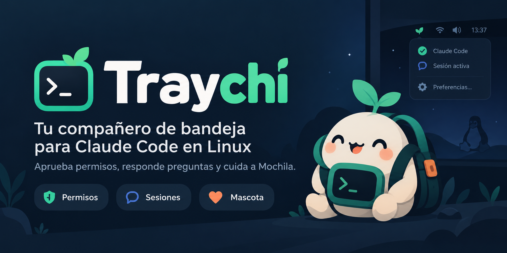
</p>

<p align="center">
  <a href="LICENSE"></a>
  
  
  
  
</p>

<p align="center">
  <b>Aprueba permisos, responde preguntas y sigue tus sesiones de Claude Code sin volver a la terminal.</b><br>
  Todo desde la bandeja del sistema, con una mascota que reacciona a lo que pasa.
</p>

<p align="center">
  <a href="#instalación">Instalar</a> ·
  <a href="#qué-puede-hacer">Funciones</a> ·
  <a href="#la-mascota">La mascota</a> ·
  <a href="#compatibilidad">Compatibilidad</a> ·
  <a href="#privacidad-y-seguridad">Privacidad</a>
</p>

---

Claude Code te pide permiso a cada rato, y si estás en otra ventana no te enteras: la sesión queda esperando. **Traychi** te avisa con una notificación elegante, te deja responder ahí mismo y vuelve a dejarte tranquilo. Si está cerrado o no contestas a tiempo, Claude Code pregunta en la terminal como siempre: **nunca te bloquea**.

```bash
git clone https://github.com/m4rtinm/traychi.git && cd traychi && ./install.sh
```

## Cómo funciona

<p align="center">
  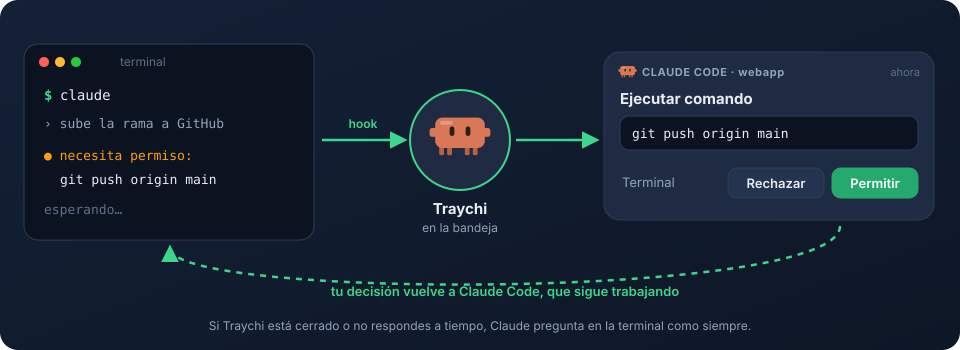
</p>

Traychi se conecta a Claude Code con sus **hooks** oficiales: pequeños scripts que Claude ejecuta en cada evento y que le pasan la información a la app por un socket local. No toca tu código ni la API.

## Qué puede hacer

<table>
  <tr>
    <td width="52%">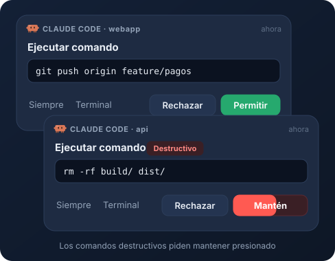</td>
    <td>
      <h3>🛡️ Aprobar o rechazar</h3>
      Cada solicitud llega como notificación, con el <b>comando o el diff a la vista</b>.
      <ul>
        <li><b>Permitir</b>, <b>Rechazar</b>, <b>Siempre</b> (aplica la regla que sugiere Claude) o <b>Terminal</b>.</li>
        <li>Los comandos destructivos (<code>rm -rf</code>, <code>git push --force</code>, <code>sudo</code>…) piden <b>mantener presionado</b>.</li>
        <li>En la esquina de la pantalla o como <b>globo sobre el icono</b>.</li>
      </ul>
    </td>
  </tr>
  <tr>
    <td>
      <h3>💬 Responder sus preguntas</h3>
      Cuando Claude pregunta con opciones, contestas desde la notificación:
      <ul>
        <li>Opción única o varias.</li>
        <li><b>Otra respuesta</b> para escribir lo que quieras.</li>
      </ul>
    </td>
    <td width="52%">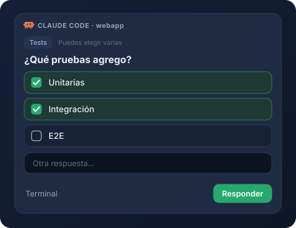</td>
  </tr>
  <tr>
    <td width="52%">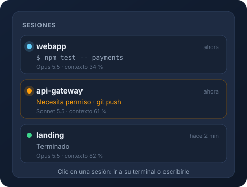</td>
    <td>
      <h3>🖥️ Todas tus sesiones</h3>
      De un vistazo: cuál <b>trabaja</b>, cuál <b>te espera</b> y cuál <b>terminó</b>, con la última herramienta, el modelo y el contexto usado.
      <ul>
        <li><b>Ir a la terminal</b>: salta a la pestaña exacta en Konsole.</li>
        <li><b>Escribirle</b>: respuestas rápidas o texto libre, sin cambiar de ventana.</li>
      </ul>
    </td>
  </tr>
  <tr>
    <td>
      <h3>📊 Consumo en tiempo real</h3>
      Las ventanas de <b>5 horas y 7 días</b> de tu plan, con la hora de reinicio, y un gráfico de <b>tokens por día</b> (7 o 30 días).
      <ul>
        <li>La mascota te avisa si hoy vas muy por encima de tu promedio.</li>
        <li>Lo lee de los datos que Claude Code ya tiene: <b>no gasta tokens</b>.</li>
      </ul>
    </td>
    <td width="52%">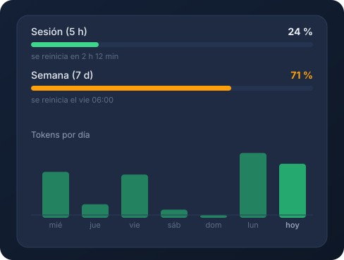</td>
  </tr>
  <tr>
    <td width="52%">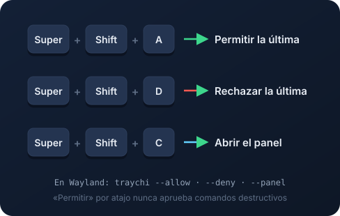</td>
    <td>
      <h3>⌨️ Sin tocar el mouse</h3>
      Atajos globales para permitir, rechazar o abrir el panel.
      <ul>
        <li>Se registran solos en X11.</li>
        <li>En Wayland, el instalador los configura en GNOME; en otros escritorios se asignan con <code>traychi --allow</code>, <code>--deny</code> y <code>--panel</code>.</li>
      </ul>
    </td>
  </tr>
</table>

Y además: **historial** con buscador de todo lo que aprobaste, rechazaste o respondiste · **sonidos** propios (uno a elección por tipo de aviso) · **modo silencio** por 30 min, 1 h o hasta mañana · tema claro u oscuro según tu escritorio.

## La mascota

<p align="center">
  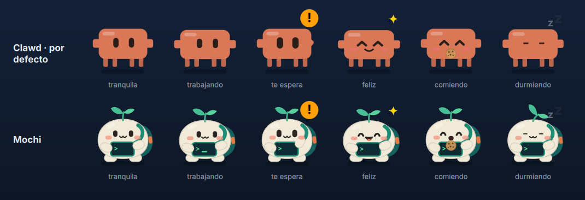
</p>

Vive en el icono de la bandeja y en el panel, y **cambia de ánimo** según lo que pasa: trabaja cuando Claude trabaja, saluda cuando algo te espera, celebra con confeti al terminar una tarea larga, se preocupa si algo falla y se duerme cuando no hay sesiones. Además **te habla**, letra por letra.

Es un pequeño **tamagotchi**: tiene hambre, energía y cariño. Le das de comer, juegas con ella y sube de nivel con tu trabajo, desbloqueando accesorios (sombrero, moño, lentes, audífonos, flor y corona). Elige entre dos diseños, **Clawd** (por defecto) y **Mochi**, y personaliza su nombre y su color.

## Capturas

<p align="center">
  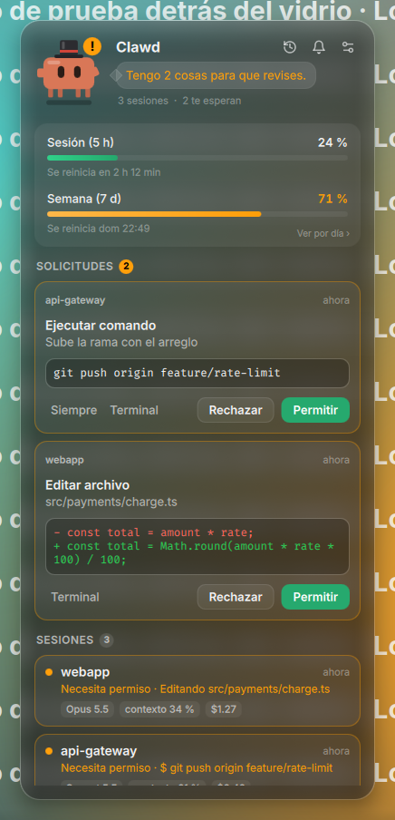
  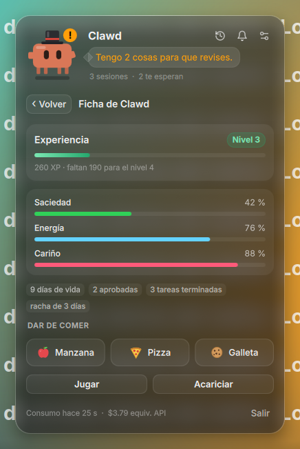
  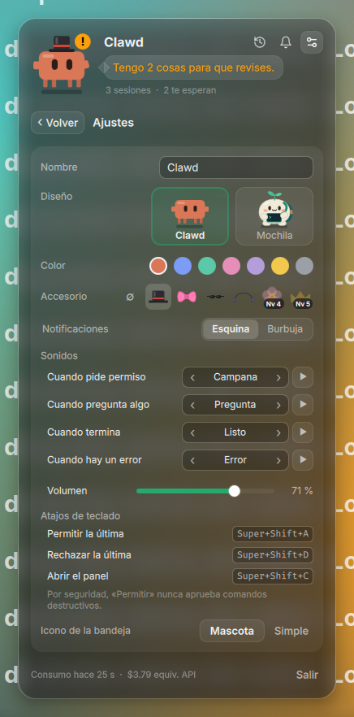
</p>
<p align="center">
  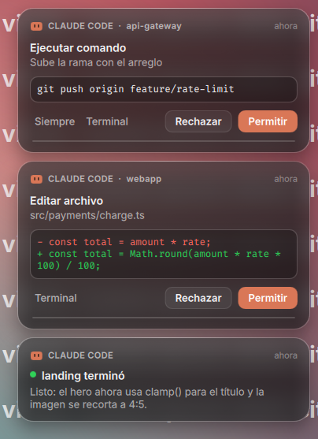
  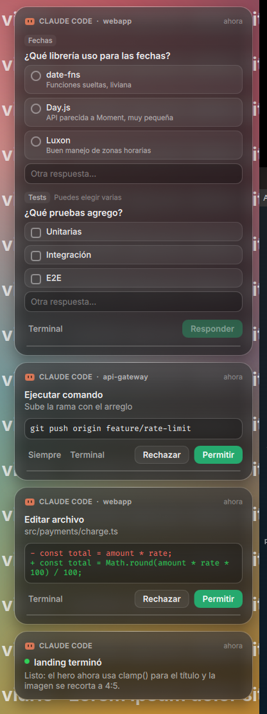
  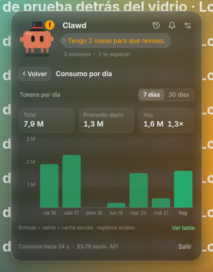
</p>

## Instalación

**Necesitas:** Linux con escritorio gráfico, [Claude Code](https://docs.claude.com/en/docs/claude-code) y `python3`.

```bash
git clone https://github.com/m4rtinm/traychi.git
cd traychi
./install.sh
```

El instalador:

1. **Revisa tu sistema** y te dice exactamente qué falta, con el comando para tu distro (apt, dnf, pacman o zypper). No instala paquetes del sistema por su cuenta.
2. **Prepara Python 3.12 con PySide6.** Si tu distro trae uno anterior (Debian 12, Ubuntu 22.04), lo resuelve con [uv](https://docs.astral.sh/uv/) sin tocar el del sistema.
3. **Copia la app** a `~/.local/share/traychi/`, así que la carpeta clonada se puede borrar.
4. **Conecta Claude Code:** agrega los hooks y la status line a `~/.claude/settings.json`, con un respaldo antes y **conservando lo que ya tenías** (tu status line se sigue mostrando).
5. **Crea el comando `traychi`**, la entrada en el menú y el **autoarranque**.

Las sesiones de Claude Code que ya estaban abiertas toman los hooks al reiniciarlas.

| Para… | Ejecuta |
|---|---|
| Actualizar | `git pull && ./install.sh` |
| Desinstalar (conserva tu historial y tu mascota) | `./install.sh --uninstall` |
| Desinstalar y borrar todo | `./install.sh --uninstall --purge` |
| Instalar sin autoarranque | `./install.sh --no-autostart` |

## Compatibilidad

Funciona en cualquier distribución con escritorio gráfico. Lo que cambia según el escritorio:

| | KDE Plasma | GNOME | XFCE, Cinnamon, MATE… |
|---|:---:|:---:|:---:|
| Icono en la bandeja | ✅ | con la extensión [AppIndicator](https://extensions.gnome.org/extension/615/) | ✅ |
| Notificaciones, panel y mascota | ✅ | ✅ | ✅ |
| Vidrio con desenfoque real | ✅ | translúcido | translúcido |
| Atajos de teclado | ✅ | ✅ | ✅ en X11 |
| Ir a la pestaña exacta | ✅ Konsole | ventana | ventana |
| Escribirle a una sesión | ✅ Konsole | — | — |

En Wayland, la app usa XWayland (incluido en todos los escritorios) para poder ubicar las notificaciones. Probado a fondo en KDE Plasma 5 (X11), y el instalador en Ubuntu 24.04, Debian 12, Fedora 41 y Arch.

## Uso

Haz clic en el icono de la bandeja para abrir el panel.

| Quiero… | Cómo |
|---|---|
| Permitir o rechazar | botones de la notificación o del panel |
| Responder en la terminal | «Terminal»: devuelve la pregunta y te lleva a ella |
| Ver el consumo por día | clic en la tarjeta de consumo |
| Ver el historial | icono del reloj |
| Silenciar | icono de la campana, o clic derecho en el icono › Silenciar |
| Cambiar ajustes y la mascota | icono de los deslizadores |
| Cuidar a la mascota | clic en ella: su ficha, con comida, juegos y nivel |

| Atajo | Acción | Comando |
|---|---|---|
| <kbd>Super</kbd>+<kbd>Shift</kbd>+<kbd>A</kbd> | permitir la última solicitud | `traychi --allow` |
| <kbd>Super</kbd>+<kbd>Shift</kbd>+<kbd>D</kbd> | rechazar la última solicitud | `traychi --deny` |
| <kbd>Super</kbd>+<kbd>Shift</kbd>+<kbd>C</kbd> | abrir o cerrar el panel | `traychi --panel` |

## Privacidad y seguridad

- 🔒 **Todo es local.** La app no se conecta a internet ni usa la API: **no consume tokens**. Solo descarga PySide6 al instalar.
- A Claude solo le llega tu decisión, igual que si contestaras en la terminal.
- La comunicación va por un **socket Unix privado** (`$XDG_RUNTIME_DIR`). Sin esa variable usa `/tmp`, pero solo si la carpeta es tuya y privada.
- Tus datos (historial, mascota, configuración, log) quedan **solo legibles para ti**, en `~/.local/share/traychi`, `~/.config/traychi` y `~/.cache/traychi`.
- Los comandos, rutas y mensajes se muestran siempre como **texto plano**: nadie puede falsear lo que ves en una notificación con HTML.
- Por atajo de teclado **nunca** se aprueba un comando destructivo.

<details>
<summary><b>Configuración avanzada</b></summary>

Casi todo se cambia en **Ajustes**. Algunas opciones extra están en `~/.config/traychi/config.json`:

| Clave | Qué hace | Por defecto |
|---|---|---|
| `approval_timeout` | segundos que espera tu respuesta antes de devolver la pregunta a la terminal | `540` |
| `shortcuts` | los atajos, p. ej. `{"allow": "Ctrl+Alt+A"}` | `Super+Shift+A/D/C` |
| `global_shortcuts` | registrar los atajos en X11 | `true` |
| `statusline_chain` | tu status line anterior, que se sigue mostrando | la que tenías |

</details>

<details>
<summary><b>Solución de problemas</b></summary>

| Problema | Solución |
|---|---|
| No veo el icono (GNOME) | Instala la extensión [AppIndicator and KStatusNotifierItem Support](https://extensions.gnome.org/extension/615/). Mientras, usa `traychi --panel`. |
| La app no abre: «cannot open shared object file» | Falta una librería de Qt: vuelve a ejecutar `./install.sh`, que te dice cuál y cómo instalarla. |
| No llegan notificaciones | Reinicia tus sesiones de `claude` (cargan los hooks al empezar) y revisa que la app esté abierta. |
| «traychi: command not found» | Agrega `~/.local/bin` a tu `PATH`; el instalador te avisa si falta. |
| Un atajo no funciona | En Ajustes › Atajos se ve si otra app ya lo usa; cámbialo en `config.json`. |
| Algo raro | Revisa `~/.cache/traychi/traychi.log`. |

</details>

<details>
<summary><b>Desarrollo</b></summary>

```bash
uv venv --python 3.12 .venv && uv pip install --python .venv/bin/python PySide6-Essentials pytest
.venv/bin/python -m pytest                       # tests
.venv/bin/python -m traychi --demo               # datos de ejemplo (también --bubble, --pet, --question, --usage, --history)
tools/test_distros.sh                            # el instalador en Ubuntu, Debian, Fedora y Arch (Docker)
tools/e2e_ask_both.sh /ruta/salida               # preguntas: se ven en la terminal y se responden por el hook
tools/e2e_ask_real.sh /ruta/salida               # lo mismo con Traychi instalado, contestando en la terminal
tools/docs_shots.sh                              # regenera las capturas
python3 tools/make_illustrations.py              # regenera las ilustraciones de docs/svg
.venv/bin/python tools/pet_showcase.py           # regenera docs/img/mascotas.png
python3 tools/make_sounds.py                     # regenera los sonidos
```

| Carpeta | Qué hay |
|---|---|
| `hook/` | los scripts que ejecuta Claude Code (solo biblioteca estándar, ~20 ms) |
| `traychi/` | la app: controlador, socket, sesiones, mascota, historial, consumo, atajos, sonidos |
| `traychi/qml/` | la interfaz (QML) |
| `install.py` | el instalador |

</details>

## Licencia

[MIT](LICENSE) © 2026 Martín Muñoz.

<sub>Traychi es un proyecto independiente y no oficial, sin relación con Anthropic. «Claude» y «Claude Code» son marcas de Anthropic; el nombre de la mascota, Clawd, es un guiño a la de Claude Code.</sub>
