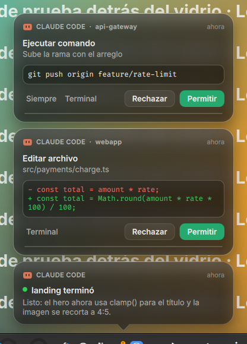

# Traychi

Un compañero de bandeja para **Claude Code** en Linux. Te avisa cuando Claude necesita algo y te deja responder **sin volver a la terminal**: aprobar o rechazar comandos, contestar sus preguntas, ver en qué está cada sesión y cuánto llevas consumido. Además trae una mascota que reacciona a lo que pasa.

> Proyecto independiente y no oficial: no está afiliado ni respaldado por Anthropic. «Claude» y «Claude Code» son marcas de Anthropic.

<p align="center">
  
  
  
</p>

## Qué hace

- **Aprobar o rechazar** cada solicitud de permiso desde una notificación, con el comando o el diff a la vista. Los comandos destructivos (`rm -rf`, `git push --force`, `sudo`…) piden **mantener presionado** «Permitir».
- **Responder las preguntas** con opciones que hace Claude, incluida una respuesta libre.
- **Ver tus sesiones:** si cada una trabaja, te espera o terminó, la última herramienta, tu mensaje y su respuesta. Desde ahí puedes **ir a su terminal** o **escribirle**.
- **Consumo en tiempo real** de las ventanas de 5 h y 7 d del plan, y un **gráfico de tokens por día** (7 o 30 días).
- **Historial** de lo aprobado, rechazado y respondido, con buscador.
- **Una mascota estilo tamagotchi** en la bandeja y en el panel: cambia de ánimo según tus sesiones, te habla, tiene hambre y energía, sube de nivel y se le pueden desbloquear accesorios.
- **Atajos de teclado, sonidos propios, modo silencio** y notificaciones en la esquina o como globo sobre el icono.

Si la app está cerrada o no respondes a tiempo, **Claude Code pregunta en la terminal como siempre**: nunca te bloquea.

<p align="center">
  
  
  
</p>

## Compatibilidad

Funciona en cualquier distribución con escritorio gráfico. Lo que cambia según el escritorio:

| | KDE Plasma | GNOME | XFCE, Cinnamon, MATE, otros |
|---|---|---|---|
| Icono en la bandeja | ✓ | con la extensión [AppIndicator](https://extensions.gnome.org/extension/615/) | ✓ |
| Notificaciones, panel, mascota | ✓ | ✓ | ✓ |
| Vidrio con desenfoque real | ✓ (KWin) | translúcido, sin desenfoque | translúcido, sin desenfoque |
| Atajos de teclado | automáticos en X11 | automáticos en X11; en Wayland los registra el instalador | automáticos en X11 |
| «Ir a la terminal» | pestaña exacta en Konsole | ventana de la terminal | ventana de la terminal |
| Escribirle a una sesión | Konsole | — | — |

- **Wayland:** la app usa XWayland, que traen todos los escritorios, para poder ubicar las notificaciones donde corresponde.
- **Probado en:**
  - KDE Plasma 5 sobre X11, con uso real.
  - Ubuntu 24.04, Fedora 41, Arch y Debian 12, solo el instalador y el arranque de la app, en contenedores.

## Requisitos

- **Linux** con escritorio gráfico.
- **[Claude Code](https://docs.claude.com/en/docs/claude-code)** instalado (el comando `claude`).
- **`python3`** para ejecutar el instalador.
- **Python 3.12 o superior para la app:**
  - si tu distro no lo trae (Debian 12, Ubuntu 22.04), el instalador lo resuelve con [uv](https://docs.astral.sh/uv/), que descarga uno aparte sin tocar el del sistema;
  - PySide6 (Qt) se descarga solo, unos 100 MB.

## Instalación

```bash
git clone https://github.com/m4rtinm/traychi.git
cd traychi
./install.sh
```

El instalador:
1. Revisa tu sistema y te dice exactamente qué falta, con el comando para tu distro (apt, dnf, pacman o zypper). **No instala paquetes del sistema por su cuenta.**
2. Copia la app a `~/.local/share/traychi/`, así que la carpeta clonada se puede borrar.
3. Prepara Python con PySide6 y comprueba que Qt cargue.
4. Conecta Claude Code: agrega sus hooks y la status line a `~/.claude/settings.json`.
   - Antes hace un **respaldo**.
   - **Conserva tus hooks y tu status line**: la tuya se sigue mostrando.
5. Crea el lanzador `traychi`, la entrada en el menú y el **autoarranque** al iniciar sesión.

Las sesiones de Claude Code que ya estaban abiertas toman los hooks nuevos al reiniciarlas.

| Para… | Ejecuta |
|---|---|
| Actualizar | `git pull && ./install.sh` |
| Desinstalar (conserva tu historial y tu mascota) | `./install.sh --uninstall` |
| Desinstalar y borrar todo | `./install.sh --uninstall --purge` |
| Instalar sin autoarranque | `./install.sh --no-autostart` |

## Uso

Haz clic en el icono de la bandeja para abrir el panel.

| Quiero… | Cómo |
|---|---|
| Permitir / rechazar | botones de la notificación o del panel |
| Permitir siempre | «Siempre»: aplica la regla que sugiere Claude Code (p. ej. `Bash(git push:*)`) |
| Responder en la terminal | «Terminal»: devuelve la pregunta y te lleva a la terminal |
| Responder una pregunta | elegir opciones (o escribir «Otra respuesta») y «Responder» |
| Escribirle a una sesión | clic en la sesión › respuestas rápidas o «Escribir a esta sesión…» (Konsole) |
| Ver el consumo por día | clic en la tarjeta de consumo |
| Ver el historial | icono del reloj |
| Silenciar | icono de la campana, o clic derecho en el icono › Silenciar (30 min, 1 h, hasta mañana…) |
| Ajustes | icono de los deslizadores: notificaciones, sonidos, atajos, mascota, icono |
| La mascota | clic en ella: su ficha, con comida, juegos y nivel |

### Atajos de teclado

| Atajo | Acción | Comando equivalente |
|---|---|---|
| `Super+Shift+A` | permitir la última solicitud | `traychi --allow` |
| `Super+Shift+D` | rechazar la última solicitud | `traychi --deny` |
| `Super+Shift+C` | abrir o cerrar el panel | `traychi --panel` |

- **En X11** la app los registra sola.
- **En Wayland,** el instalador los registra en GNOME. En otros escritorios, asigna los comandos en los atajos del sistema.
- Por seguridad, «permitir» por atajo **nunca aprueba comandos destructivos**.

## Privacidad y seguridad

- **Todo es local.** La app no se conecta a internet ni usa la API: **no consume tokens**. Solo descarga PySide6 al instalar.
- A Claude solo le llega tu decisión (permitir, rechazar o tu respuesta), igual que si contestaras en la terminal.
- La comunicación con los hooks va por un socket Unix privado, en `$XDG_RUNTIME_DIR`. Si esa variable no existe, la app usa `/tmp`, pero solo si la carpeta es tuya y privada.
- Tus datos quedan solo legibles para ti (carpetas 0700, archivos 0600):

  | Qué | Dónde |
  |---|---|
  | Historial | `~/.local/share/traychi/history.jsonl` |
  | Configuración y mascota | `~/.config/traychi/` |
  | Log | `~/.cache/traychi/traychi.log` |

- Los textos de comandos, rutas y mensajes se muestran siempre como texto plano: el HTML nunca se interpreta, así nadie puede falsear lo que ves en una notificación.

## Configuración

Casi todo se cambia en **Ajustes**. Algunas opciones extra están en `~/.config/traychi/config.json`:

| Clave | Qué hace | Por defecto |
|---|---|---|
| `approval_timeout` | segundos que espera tu respuesta antes de devolver la pregunta a la terminal | `540` |
| `shortcuts` | los atajos, p. ej. `{"allow": "Ctrl+Alt+A"}` | `Super+Shift+A/D/C` |
| `global_shortcuts` | registrar los atajos en X11 | `true` |
| `statusline_chain` | tu status line anterior, que se sigue mostrando | la que tenías |

## Solución de problemas

| Problema | Solución |
|---|---|
| No veo el icono (GNOME) | Instala la extensión [AppIndicator and KStatusNotifierItem Support](https://extensions.gnome.org/extension/615/). Mientras, usa `traychi --panel`. |
| La app no abre: «cannot open shared object file» | Falta una librería de Qt. Vuelve a ejecutar `./install.sh`: te dice cuál y el comando para instalarla. |
| No llegan notificaciones | Reinicia tus sesiones de `claude`, que cargan los hooks al empezar. Revisa que la app esté abierta. |
| «traychi: command not found» | Agrega `~/.local/bin` a tu `PATH` (el instalador te avisa si falta). |
| Un atajo no funciona | En Ajustes › Atajos se ve si otra app ya lo usa. Cámbialo en `config.json`. |
| Algo raro | Mira `~/.cache/traychi/traychi.log`. |

## Desarrollo

```bash
uv venv --python 3.12 .venv && uv pip install --python .venv/bin/python PySide6-Essentials pytest
.venv/bin/python -m pytest                          # tests
.venv/bin/python -m traychi --demo               # datos de ejemplo (también: --bubble, --pet, --question, --usage, --history)
tools/test_distros.sh                               # el instalador en Ubuntu, Debian, Fedora y Arch (Docker)
tools/e2e_ask.sh /ruta/salida                       # prueba real de AskUserQuestion con Claude Code (Konsole aparte)
tools/docs_shots.sh                                 # regenera las capturas de docs/img
python3 tools/make_sounds.py                        # regenera los sonidos
```

Estructura:

- `hook/`: los scripts que ejecuta Claude Code. Solo usan la biblioteca estándar y tardan unos 20 ms.
- `traychi/`: la app (PySide6 + QML).
  - `app.py`: el controlador.
  - `bridge.py`: el socket.
  - `state.py`: las sesiones y el consumo.
  - `pet.py`: la mascota.
  - `history.py`: el historial.
  - `usagehist.py`: los tokens por día.
  - `describe.py`: el resumen de cada herramienta y la detección de comandos destructivos.
  - `glass.py`: el desenfoque de KWin.
  - `hotkeys.py`: los atajos de X11.
  - `focus.py`: la integración con la terminal.
  - `sound.py`: los sonidos.
  - `qml/`: la interfaz.
- `install.py`: el instalador.

## Licencia

[MIT](LICENSE) © 2026 Martín Muñoz.
